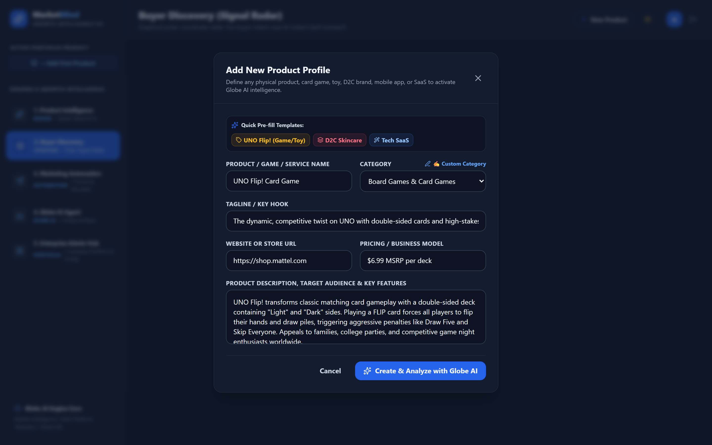
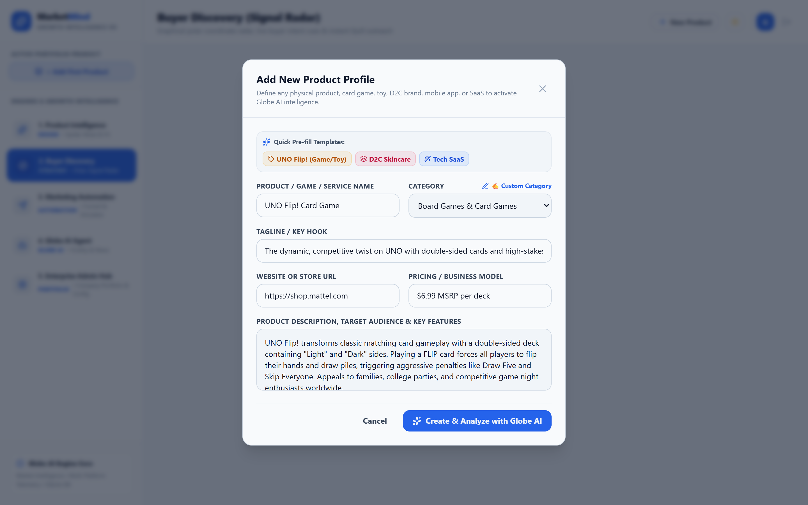
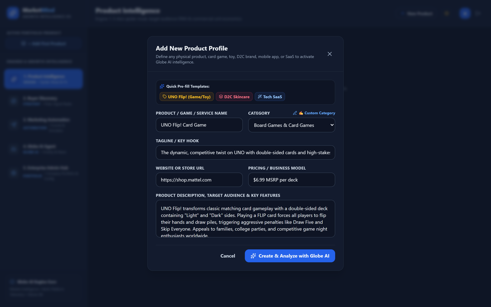
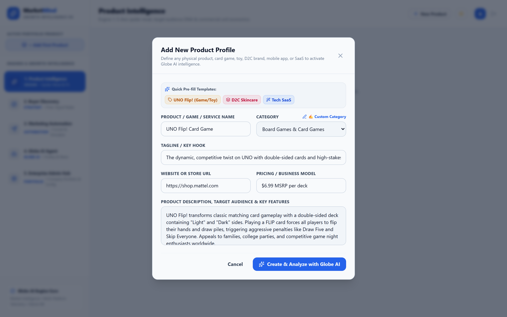
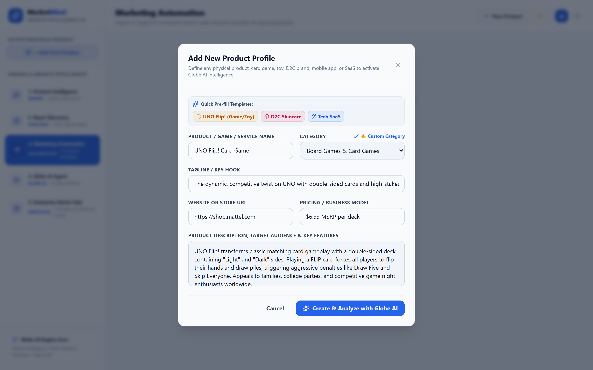
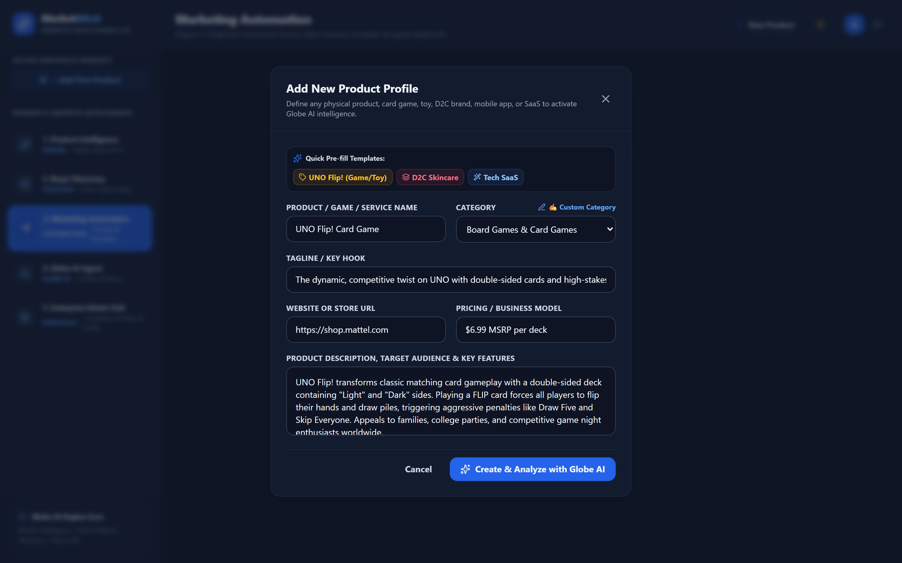
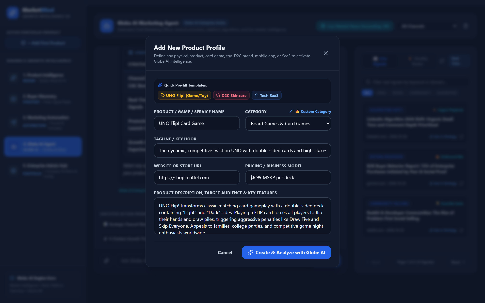
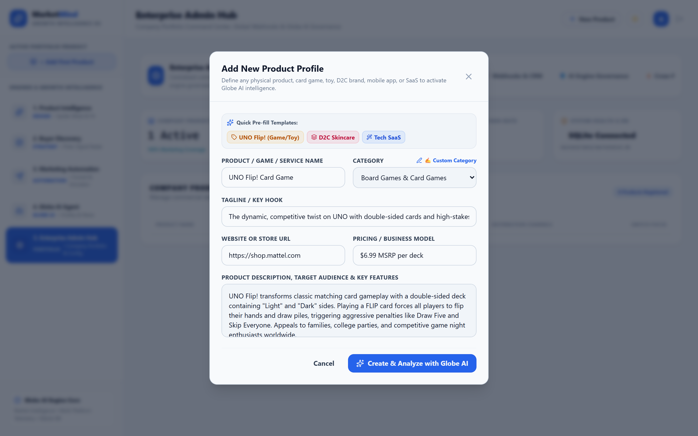
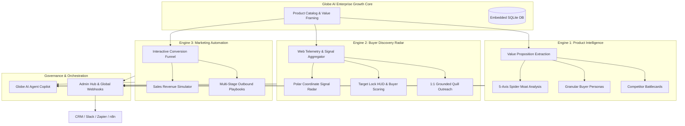

# MarketMind AI 🚀
> **Enterprise Growth Intelligence & Autonomous Buyer Discovery Operating System**

[](LICENSE)
[](https://spring.io/projects/spring-boot)
[](https://react.dev/)
[](https://www.typescriptlang.org/)
[](https://tailwindcss.com/)
[](https://www.sqlite.org/)

**MarketMind AI** is an internal enterprise growth platform designed for single-company portfolio marketing. It bridges deep product analysis, live web buyer intent telemetry, and automated multi-channel campaign execution into a unified, walled operating system powered by **Globe AI**.

---

## 📸 Interface Showcase (Dark & Light Modes)

### 1. Polar Signal Radar & Live Buyer Discovery
*Real-time polar coordinate radar plotting prospective buyer accounts by intent distance, featuring verified live-web catalyst triggers and instant executive outreach drafts.*

| Dark Mode (Tactical Radar Scope) | Light Mode (Sales & Distribution Intelligence) |
| :---: | :---: |
|  |  |

---

### 2. Product Intelligence & 5-Axis Spider Moat
*Automated value proposition framing, comprehensive customer persona generation, competitor battlecards, and defensible moat evaluation.*

| Dark Mode (Spider Moat & Fit Assessment) | Light Mode (Executive Summary & Unit Economics) |
| :---: | :---: |
|  |  |

---

### 3. Marketing Automation & Revenue Forecasting
*Dynamic conversion funnel simulator and algorithm-grounded multi-channel campaign playbooks for email, LinkedIn, and social distribution.*

| Light Mode (Funnel & Revenue Simulator) | Dark Mode (Campaign Playbooks & Asset Review) |
| :---: | :---: |
|  |  |

---

### 4. Globe AI Strategic Copilot & Enterprise Admin Hub
*Dedicated growth strategist with real-time news grounding alongside the central company portfolio command hub.*

| Dark Mode (Globe AI Marketing Agent) | Light Mode (Enterprise Admin Hub) |
| :---: | :---: |
|  |  |

---

## ⚡ Key Architectural Capabilities



### 🎯 Five Integrated Engines
1. **Product Intelligence Engine (`DESIGN`)**:
   - 5-Axis Spider Moat visualization (Value Clarity, Pricing Power, Channel Fit, Velocity, Defensibility).
   - Dynamic ICP and Customer Persona synthesis (seniority, operational friction, key conversion levers).
   - Competitor positioning matrices with counter-positioning angles.
2. **Buyer Discovery Engine (`STRATEGY`)**:
   - Polar coordinate radar scope visualizing hot-core ($\ge 90\%$), warm-pipeline ($80\%-89\%$), and broad-market ($70\%-79\%$) buyer accounts.
   - Live web signal scraping across hiring notices, vendor expansions, procurement RFPs, and executive migrations.
   - Fact vs. Hypothesis governance: every signal cites verbatim text, source publication, and timestamp.
3. **Marketing Automation Engine (`AUTOMATION`)**:
   - Interactive conversion funnel adjusting traffic volume, CTR, conversion rates, and ACV.
   - Automated 3-stage email sequences (Pain Hook, Proof Engine, Executive Ask).
   - High-dwell-time LinkedIn authority posts, Twitter/X threads, and targeted ad copy.
4. **Globe AI Growth Director (`COPILOT`)**:
   - Real-time market news integration and social algorithm shift updates.
   - Copywriting assistant, tactical guerrilla growth plays, and file attachment support.
5. **Enterprise Admin Hub (`GOVERNANCE`)**:
   - Central product portfolio management (add, edit, toggle, inspect company products).
   - Global outbound webhook dispatching (Slack channels, Make, Zapier, n8n).
   - System telemetry, Groq high-speed LLM monitoring, and CSV/JSON pipeline export.

---

## 🛠️ Technology Stack

| Component | Technology | Description |
| :--- | :--- | :--- |
| **Frontend Framework** | React 19 + TypeScript | Componentized modern SPA architecture |
| **Styling & Theme** | Tailwind CSS 3.4 | Smooth walled backgrounds, Cobalt & Slate palette (zero AI gradient cliches) |
| **Motion & Icons** | Framer Motion & Lucide React | High-performance tactile transitions and iconography |
| **Backend Framework** | Java 17+ / Spring Boot 3.3.5 | Robust enterprise RESTful micro-architecture |
| **Security & Auth** | Spring Security 6 + JWT | Stateless token-based authentication with role verification |
| **Database** | SQLite + Hibernate Community Dialect | Embedded zero-configuration transactional database |
| **AI Orchestration** | High-Speed Groq LLM API (`gpt-oss-120b`) | Sub-second generative marketing intelligence and copy synthesis |
| **Web Signal Telemetry**| Tavily Search API | Authentic, verified real-world market intelligence gathering |
| **Documentation** | OpenAPI 3 / Swagger UI | Interactive API exploration at `/swagger-ui.html` |

---

## 🚀 Quick Start Guide

### Prerequisites
- **Java 17 LTS or higher** (`java -version`)
- **Maven 3.8+** (`mvn -v`)
- **Node.js 18+ & npm** (`node -v`)

### 1. Clone the Repository
```bash
git clone https://github.com/gondchawarswaraj45/MarketMind-AI.git
cd MarketMind-AI
```

### 2. Configure Environment Variables
Copy the template configuration file:
```bash
cp .env.example .env
```
Update `.env` with your desired configuration (API keys are kept strictly local and ignored by Git):
```properties
GROQ_API_KEY=your_groq_api_key_here
GROQ_MODEL=openai/gpt-oss-120b
SERVER_PORT=8080
VITE_API_BASE_URL=http://localhost:8080/api/v1
```

### 3. Launch Services (Windows One-Click)
Double-click `start.bat` or run:
```cmd
start.bat
```

### 4. Manual Startup
#### Backend (Port 8080):
```bash
cd backend
mvn spring-boot:run
```
*API Swagger Documentation: [http://localhost:8080/swagger-ui.html](http://localhost:8080/swagger-ui.html)*

#### Frontend (Port 5173):
```bash
cd frontend
npm install
npm run dev
```
*Web Application: [http://localhost:5173](http://localhost:5173)*

---

## 🔒 Security & Privacy Notice
- **No Sensitive Data Committed**: All API keys, production tokens, credentials, and local database files are excluded via `.gitignore`.
- **Private Portfolio Isolation**: Designed specifically for internal corporate usage to safely market company products without leaking sensitive competitive IP.

---

## 📄 License
This project is licensed under the [MIT License](LICENSE).
