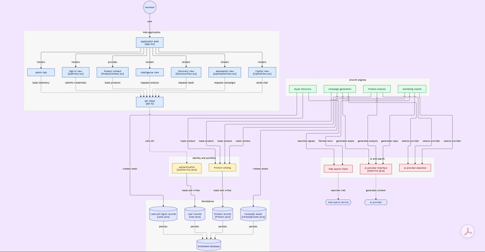
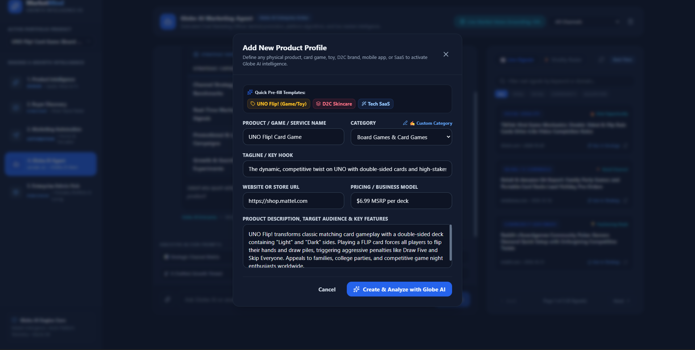
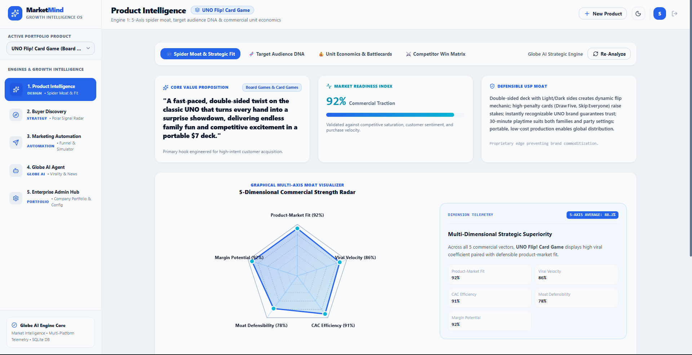
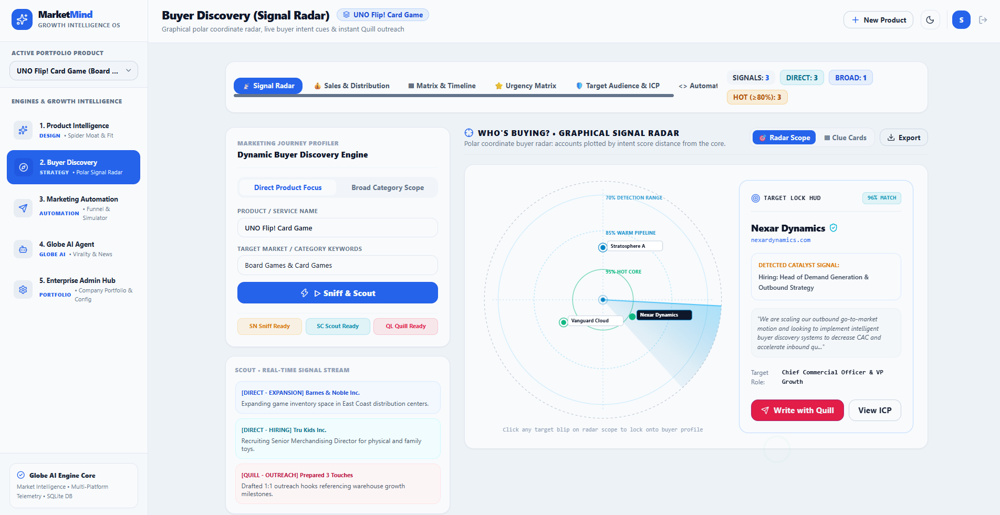

# MarketMind AI 🚀
> **Enterprise Growth Intelligence & Autonomous Buyer Discovery Operating System**

[](LICENSE)
[](https://spring.io/projects/spring-boot)
[](https://react.dev/)
[](https://www.typescriptlang.org/)
[](https://tailwindcss.com/)
[](https://www.sqlite.org/)
[](https://groq.com/)

---

## Executive Overview

**MarketMind AI** is an enterprise-grade growth intelligence operating system built for single-company portfolio marketing, competitive positioning, and proactive buyer discovery. Rather than relying on disconnected spreadsheets, fragmented ad dashboards, and generic generative AI wrappers, MarketMind AI orchestrates a cohesive, closed-loop growth pipeline:

1. **Strategic Product Intelligence**: Deep-dive algorithmic analysis of product moats, 5-axis commercial strength benchmarks, and ICP (Ideal Customer Profile) DNA.
2. **Dynamic Buyer Discovery**: Real-time polar coordinate radar that tracks live market signals, hiring catalysts, and expansion triggers, plotting accounts by conversion proximity.
3. **Marketing Automation & Conversion Modeling**: End-to-end commercial funnel diagnostics mapping impressions to closed-won revenue with leak detection and automated outbound generation.
4. **Globe AI Growth Director**: Autonomous CMO agent grounded with live market telemetry, platform algorithm adaptations, and verified competitive moves.

Designed with a walled, human-centric design philosophy, the interface features custom cobalt and slate tones, tactile visual controls, and zero AI gradient cliches.

---

## 🏛️ System Architecture

MarketMind AI follows a modern, decoupled micro-architecture combining a high-performance **React 19 + TypeScript** frontend with a robust **Spring Boot 3.3.5 (Java 17+)** enterprise backend, backed by zero-configuration embedded persistence and ultra-low-latency Groq AI inference.

[](https://gitdiagram.com/gondchawarswaraj45/marketmind-ai?utm_source=readme&utm_medium=picture)



### Core Architectural Layers:

- **Client Presentation Layer (`frontend/`)**: Built on React 19, Vite, and Tailwind CSS. Provides modular views for Product Intelligence, Buyer Discovery, Marketing Automation, Globe AI Agent, and Enterprise Administration with responsive dual-theme support.
- **Enterprise Service Layer (`backend/`)**: Spring Boot REST micro-architecture enforcing strict type safety, centralized exception handling, and stateless JWT authentication.
- **AI Service Factory & Search Telemetry**: Pluggable provider architecture (`AiServiceFactory`) allowing seamless routing between Groq LPU models (`gpt-oss-120b`, `llama-3.3-70b-versatile`) with sub-second response times, integrated with Tavily Search API for verified live web market data.
- **Embedded Persistence**: Zero-configuration, file-based SQLite database with automated schema initialization, indexing, and transactional isolation.

---

## 📸 Interface Showcase

### 1. Dynamic Portfolio Onboarding & Value Hook Framing
*Rapidly define any physical product, card game, retail toy, D2C brand, mobile app, or SaaS offering with instant pre-fill templates and Globe AI automated analysis.*



- **One-Click Sector Templates**: Rapid presets for Game/Toy (`UNO Flip!`), D2C Skincare, and Tech SaaS.
- **Commercial Hook Engineering**: Captures core taglines, pricing models, retail MSRP, target audience, and primary hooks.
- **Globe AI Analysis Dispatcher**: Directly triggers automated commercial spider moat synthesis and target audience generation upon creation.

---

### 2. Engine 1: Product Intelligence & 5-Dimensional Commercial Strength Radar
*Algorithmic evaluation of product defensibility, value proposition framing, and multi-axis commercial viability.*



- **5-Dimensional Commercial Strength Radar**: Graphical multi-axis spider chart measuring:
  - **Product-Market Fit (92%)**: Demand alignment and customer sentiment velocity.
  - **Viral Velocity (86%)**: Organic referral coefficients and social share dynamics.
  - **CAC Efficiency (91%)**: Capital efficiency and customer acquisition economics.
  - **Moat Defensibility (78%)**: Barriers to entry and protection against brand commoditization.
  - **Margin Potential (92%)**: Production unit economics and retail pricing resilience.
- **Commercial Readiness Index**: Dynamic quantitative readiness score (92% Commercial Traction).
- **Automated Value Proposition Synthesis**: Generates targeted hooks, defensible USP statements, and competitive counter-positioning angles.

---

### 3. Engine 2: Dynamic Buyer Discovery & Graphical Polar Signal Radar
*Polar coordinate radar displaying prospective buyer accounts plotted by intent score distance from the core, coupled with live catalyst signal tracking and instant 1:1 outreach.*



- **Polar Coordinate Signal Radar**:
  - **95% Hot Core**: Immediate purchase intent and ready-to-close accounts.
  - **85% Warm Pipeline**: Active evaluation and relevant leadership hiring triggers.
  - **70% Detection Range**: Early-stage exploratory interest and broad category relevance.
- **Target Lock HUD**: Real-time blip inspection displaying account match confidence (e.g. *Nexar Dynamics - 96% Match*), website, target decision-maker role, and detected catalyst signals.
- **Scout Real-Time Signal Stream**: Monitors corporate expansion, executive recruitment, and distribution moves across target retail and enterprise accounts.
- **Quill Outreach Generator**: One-click synthesis of highly personalized, context-aware 1:1 executive outreach hooks.

---

## ⚙️ Core Engines Breakdown

| Engine | Core Capability | Business Outcome |
| :--- | :--- | :--- |
| **1. Product Intelligence** | 5-Axis Spider Moat, Target Audience DNA, Unit Economics Battlecards, Competitor Win Matrix | Eliminates guesswork in value proposition framing; identifies high-margin strategic moats. |
| **2. Buyer Discovery** | Polar Coordinate Signal Radar, Real-Time Signal Scout, Target Lock HUD, Grounded Quill Outreach | Proactively identifies in-market buyers based on live hiring, expansion, and tech adoption triggers. |
| **3. Marketing Automation** | Full-Cycle Commercial Conversion Funnel, Sales Revenue Forecaster Simulator, Outbound Playbooks | Pinpoints commercial conversion leakage across all 5 funnel stages and models revenue impact. |
| **4. Globe AI Agent** | Autonomous Marketing Copilot, Real-Time Market Grounding, Platform Virality & Algorithm Feeds | Acts as an always-on Chief Marketing Officer delivering tactical copy, threads, and campaign playbooks. |
| **5. Enterprise Admin Hub** | Multi-Product Portfolio Switcher, Telemetry Monitoring, Global Webhook Integrations | Unified governance across enterprise assets with export bridges to CRM, Slack, and automation webhooks. |

---

## 🛠️ Technology Stack

| Layer | Technologies | Key Highlights |
| :--- | :--- | :--- |
| **Frontend Framework** | React 19, TypeScript, Vite | Sub-millisecond HMR, type-safe state architecture |
| **UI & Styling** | Tailwind CSS 3.4, Lucide React, Framer Motion | Custom slate/cobalt palettes, tactile animations, responsive themes |
| **Backend Framework** | Java 17+, Spring Boot 3.3.5 | Production-grade REST micro-services, declarative transactions |
| **Security & Auth** | Spring Security 6, JJWT (JSON Web Token) | Stateless JWT authentication, CORS safeguards, BCrypt password hashing |
| **Database & ORM** | SQLite, Spring Data JPA, Hibernate | Zero-configuration portable embedded storage with production schema migration |
| **AI Inference** | Groq LPU Hardware Acceleration | Low-latency LLM synthesis (`gpt-oss-120b`, `llama-3.3-70b-versatile`) |
| **Market Telemetry** | Tavily Search API | Real-time web signal gathering, news verification, and competitor monitoring |
| **API Documentation** | OpenAPI 3.0, Swagger UI | Interactive REST endpoint documentation and testing suite |

---

## 🚀 Quick Start Guide

### Prerequisites
Ensure your local environment meets the following requirements:
- **Java 17 LTS or higher** (`java -version`)
- **Maven 3.8+** (`mvn -v`)
- **Node.js 18+ & npm** (`node -v`)
- **Git** (`git --version`)

---

### Step 1: Clone Repository
```bash
git clone https://github.com/gondchawarswaraj45/MarketMind-AI.git
cd MarketMind-AI
```

---

### Step 2: Configure Environment Variables
Copy the template configuration file:
```bash
cp .env.example .env
```

Edit `.env` to configure your API keys (credentials are strictly excluded from version control):
```properties
# Groq AI Inference Credentials
GROQ_API_KEY=your_groq_api_key_here
GROQ_MODEL=openai/gpt-oss-120b

# Optional: Tavily Search Key for Live Web Grounding
TAVILY_API_KEY=your_tavily_api_key_here

# Server & Network Ports
SERVER_PORT=8080
VITE_API_BASE_URL=http://localhost:8080/api/v1
```

---

### Step 3: Launch Application

#### Option A: Windows One-Click (Recommended)
Double-click `start.bat` or run from PowerShell / Command Prompt:
```cmd
.\start.bat
```
*This automatically starts the Spring Boot backend on port 8080 and Vite frontend on port 5173.*

#### Option B: Manual Startup

**1. Launch Backend:**
```bash
cd backend
mvn clean spring-boot:run
```
*The backend API initializes on `http://localhost:8080`.*
*Interactive Swagger documentation is available at `http://localhost:8080/swagger-ui.html`.*

**2. Launch Frontend:**
```bash
cd frontend
npm install
npm run dev
```
*The frontend user interface launches at `http://localhost:5173`.*

---

## 🔒 Security & Enterprise Confidentiality

- **Strict Secret Isolation**: All sensitive credentials, API keys, and local SQLite database files are excluded from Git version control via `.gitignore`.
- **Stateless JWT Authentication**: Every REST API transaction is authenticated using cryptographic bearer tokens with configurable expiration windows.
- **Walled Private Operating System**: Purpose-built for single-company portfolio growth without sharing data across external multi-tenant pools.
- **Sanitized Logging**: All application logs redact authorization headers and proprietary marketing assets.

---

## 📄 License

This project is licensed under the [MIT License](LICENSE).
